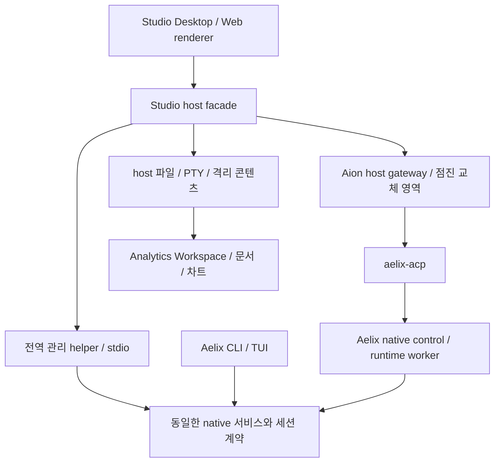

# Aelix Studio Preview → 첫 Beta 출시 설계

> 2026-10-24–25 소스 감사에서 작성한 설계다. 이 문서의 현재/미구현 표시는 당시 후보 기준이며, 현행 main·실행 Issue·착수 순서는 [readiness.md](readiness.md)에서 확인한다. 기술 제안과 제품 실행 수용은 구분한다.

상태: **Proposed** · 작성 시작: 2026-10-24 · 검토 완료: 2026-10-25 Asia/Seoul.
사용자가 요구한 제품 목표와 아래의 구현 제안을 구분한다. 이 문서는 출시 승인,
ADR 채택, 기존 구현 변경, PR 병합 또는 배포 완료를 의미하지 않는다.

## 1. 결론

초기 제품은 AionUi에서 유래한 Studio의 화면·배포 기반을 활용하되, **Aelix가 실행,
설정, 자격 증명, 프로필, 리소스, 세션 의미론의 정본**을 소유한다.
ACP는 다른 IDE/클라이언트에서도 사용할 수 있는 프로토콜 어댑터로 유지한다.
Studio는 설치·호스트 연결·관리 화면·파일/미리보기·사용자 경험을 책임진다.

beta.2 기준 Preview는 내부 검증 빌드로 두고, Studio의 첫 공개 릴리스인 첫 Beta는
Aelix beta.3 및 Analytics 첫 Beta와 **동일한 릴리스 트레인**으로 낸다(D13).
향후 Aion 구성 요소를 교체하더라도 이 두 출시를 처음부터 다시 구현하지 않는다.

현재 제한적인 beta.2 연결 후보를 사용자의 TUI 기능 요구를 충족한 Preview로
승격하지 않는다. API가 있다는 것, UI가 호출한다는 것, 설치 앱에서 동작한다는
것은 별도의 수용 상태다. 필요한 기능이 없으면 출시 차단으로 남긴다.

## 2. 승인된 요구와 설계 제안

사용자 요구로 고정한 것:

1. beta.2 기준 첫 Studio Preview, beta.3·Analytics 첫 Beta와 함께 Studio 첫 Beta.
   2026-10-29부터 Preview는 내부 검증용이고 첫 공개 릴리스는 공동 Beta다(D13).
2. 초기부터 세션 중 모델/추론 변경, 추론 스트리밍, context 조회, compact,
   세션 관리 등 실제 작업 흐름을 커버. 모든 TUI 슬래시 명령을 복제하지 않는다.
   context 표시·설정·fork/import/clone 등은 Aion의 기존 표면에 native 기능을 연결한다.
   `/clear`는 재구현 대상에서 제외한다. 이는 2026-10-25 사용자의 범위 명확화다.
3. 신규 설치 → Provider 설정 → 첫 실행과, 기존 CLI 사용자 설정·세션 연결.
4. 작은 core와 넓은 확장 표면, 여러 Aelix 프로필 구성, 확장 설치/on-off,
   도구/스킬 on-off, 적용 결과와 실패를 쉽게 확인하는 관리 UI.
5. CLI와 Studio의 세션 보기·실시간 반영. 초기에는 한 writer만 허용하고,
   상대 실행을 종료한 뒤 이어받는 안내와 안전한 소유권 전환을 제공할 수 있음.
6. Aion upstream main을 추적하면서 상당한 부분을 Aelix로 점진 교체.
7. 기존 출시 요구인 macOS/Windows/Linux, 단일 운영자 self-hosted WebUI와
   모바일 브라우저, 차단 네트워크, Coding/Analytics 및 팀 기능을 보존.
   기업 IdP SSO는 후속 범위다. 네이티브 모바일 앱 출시는 별도 결정이다.
8. Studio 첫 Beta 출시 시 Aelix 공식 홈페이지에도 Studio 소개와 다운로드·시작
   안내를 반영한다. core beta.3·Analytics Beta·Studio Beta의 공동 출시 조건에 포함한다.
   이 항목은 2026-10-25 사용자가 추가한 요구다.
9. Preview는 공개 beta.2 본체/wheel을 수정하지 않는다. Studio·ACP·별도 확장/관리
   helper에서 구현하며 기존 beta.2 CLI에 전용 core 빌드나 강제 업그레이드를 요구하지 않는다.
10. Preview뿐 아니라 **첫 Beta까지 기존 Aion UI 표면 연결을 최대한 우선**한다.
    기존 화면·selector·설정창·sidebar·preview/browser를 재사용하고 새 전용 표면은
    기존 표면으로 충족할 수 없는 필수 기능에 필요한 최소 범위로 한정한다.

아래의 서비스 배치, 버전명, 작업 패키지, 대체 순서, 타임아웃/화면 정책은 제안이다.
경쟁 제품의 모든 기능을 무제한으로 복제한다는 약속 대신, 이 문서의 사용자 여정과
[TUI 커버리지](tui-coverage.md)를 검증 가능한 최소선으로 삼는다.

## 3. 설계 감사 당시 기준점과 증거의 범위

| 구성 요소  | 원격/공개 기준                                                     | 작업 중 기준                                                                       | 판정                                                                    |
| ---------- | ------------------------------------------------------------------ | ---------------------------------------------------------------------------------- | ----------------------------------------------------------------------- |
| Aelix core | beta.2 태그 `1093cc2578e70500c91fe0a8d340b7db2528c8de`             | main `3a841059ea518a0d849b912eb7ffd7d85bb87bcc`                                    | main은 beta.3 개발 후보. 양쪽 package version이 b2여도 같은 기능이 아님 |
| ACP        | main `71eabb42b3c97e089e7d8601bc32b310ee40dbea`                    | PR #1/HEAD `8deb482bcd53261762979cf0e6ce1302dcc821c1` + beta.2 dirty 작업          | main/PR/작업 트리를 분리                                                |
| Studio     | main `886dcbdeabeee77867daf47ed99548140f05b378`, 공개 release 없음 | bootstrap `3a8763cfd56acd52024b4a0634acaca7cedb48e4` + runtime-controls dirty 작업 | bootstrap CI 성공은 후속 작업의 CI가 아님                               |
| Analytics  | main `c73655b0a578e3d3ed05a21795f77928cb04a0bd`, 공개 release 없음 | Studio가 source-pinned kit 0.26.0 사용                                             | kit 버전과 첫 제품 Beta 출시는 별도                                     |
| Aion 기반  | AionUi v2.2.2 / `6744099b279b991c17e31c243f0920477bd31cb6`         | AionCore v0.2.2 유지                                                               | upstream provenance와 기능 소유권을 함께 관리                           |

원격 main/열린 PR은 2026-10-25 00:11 KST 읽기 전용 API 재확인에서도 동일했다.
release 목록은 2026-10-24 확인값이다. Studio의 upstream 정책
`36920e764`는 별도 브랜치이고 main 채택으로 계산하지 않는다.
기존 설치/실모델/CI 기록은 각 문서의 SHA·artifact·범위에서만 유효하다.
이번 설계 작업은 제품 테스트를 재실행하거나 기존 dirty 변경을 수정하지 않는다.

현재 핵심 공백:

- Aion Provider 화면의 `/api/providers`는 Aelix AuthStorage 관리 화면이 아니다.
- 표준 model/config UI는 일부 재사용 가능하지만 `_aelix/manage`와 client action의
  Studio host 통로·전용 관리 화면은 아직 별도 작업이다.
- ACP 세션 인덱스/lease는 외부 CLI 세션 전체의 catalog·writer 소유권과 같지 않다.
- main의 native read-only storage는 열린 시점 snapshot이다. live viewer 계약은 남는다.
- 공개 beta.2 CLI는 main의 writer-lock/read-only 모듈을 포함하지 않는다.
- 기존 child 이벤트와 일부 도구 상세 정보는 재접속 후 복원 계약이 부족하다.
- ACP의 16 MiB reader/wire 경계와 native 전체 aggregate/history 경로를 검증하지 않고
  긴 세션 수용을 선언할 수 없다. native JSONL 저장 자체의 크기 한도와 구분한다.

## 4. beta.2 본체 무수정 기준 — D01

| 선택                                | 의미                                                                                                        | 사용자 요구에 대한 결과                                                                                                                |
| ----------------------------------- | ----------------------------------------------------------------------------------------------------------- | -------------------------------------------------------------------------------------------------------------------------------------- |
| A. 공개 beta.2 wheels 그대로        | native wheel 무수정. ExtensionAPI/CLI와 명시적으로 pin한 native library 심볼을 사용하는 adapter·관리 helper | 사용자 선택 기준. auth bootstrap/fork/MCP startup 및 Ask/Yolo는 추가 구현 후보. 현재 미노출을 beta.2의 기술적 불가능으로 단정하지 않음 |
| B. beta.2 태그 + host 호환 backport | 기존 검토에서 비교했던 별도 수정 core 배포                                                                  | Preview 경로에서 제외. 사용자의 본체 수정 제한과 충돌                                                                                  |
| C. beta.3 main snapshot을 b2로 포장 | package version 문자열만 보고 최신 main을 사용                                                              | 거부. 의존성과 검증 기준을 오인시킴                                                                                                    |

**현재 기준:** A로 고정한다. 기능의 표면은 Aion UI를 우선 재사용하고 native binding을
추가한다. Ask/Yolo 두 모드를 Preview 설계안으로 삼되 실제 wheel/host 검증 전에는
지원 완료로 광고하지 않는다. 남는 제약과 UI 재사용 경로는
[beta.2 호환·UI 연결](beta2-public-surface.md)에 구분했다. Beta도 실제 공개 beta.3를
사용하며 Studio만을 위한 private core patch를 기본 배포 경로로 삼지 않는다.

무수정 wheel 사용과 모든 호출 심볼의 장기 공개 API 안정성은 다르다. 현재 bridge도
native 내부 helper를 import한다. 사용 심볼·버전·호출 의미를 compatibility manifest에
기록하고 **실제 배포 wheel**에서 검증한다. 이번 beta.2 소스 감사만으로 공개 wheel과
tag의 byte 동일성까지 확인했다고 주장하지 않는다. 기능별 가능 경로와 한계는
[검토 종합](review-synthesis.md)에 정리했다.

기존 beta.2 CLI가 잠금 계약에 참여하지 않는 경우 같은 파일의 안전한 writer
handoff를 약속할 수 없다. 보기/복제 분기만 제공하거나 호환 CLI 업그레이드를
안내한다. 자세한 조건은 [세션 계약](session-and-management-contracts.md#2-세션의-정체성과-소유권) 참조.

## 5. 출시 단계와 필수 약속

| 영역          | P: beta.2 기반 Preview                                                                                 | B: beta.3·Analytics·Studio 첫 Beta                                                                  | 이후                                             |
| ------------- | ------------------------------------------------------------------------------------------------------ | --------------------------------------------------------------------------------------------------- | ------------------------------------------------ |
| 설치/시작     | 시스템 Python/소스 없이 설치, Provider 설정·기존 CLI 감지·첫 응답                                      | upgrade/uninstall/rollback 및 기존 사용자 migration 검증                                            | 조직 관리·배포 확장                              |
| 대화 제어     | 모델·추론·stream·Ask/Yolo·중단·context 표시·compact, 기존 Aion 분기/설정 UI 연결. clear 별도 구현 제외 | 공개 beta.3 기능을 기준으로 실제 작업을 host UI로 수용. 슬래시 명령 전수 복제는 요구하지 않음       | 고급 편집·협업                                   |
| 관리          | 프로필 작성/선택, 확장 설치/on-off, 도구/스킬 on-off를 실제 실행에 반영                                | profile CRUD, schema-driven 관리, 표준 native dialog/extension 명령, 출처·오류·복구                 | 확장별 웹 기여 표면                              |
| CLI 세션      | 발견·정체성 연결·소유자 표시·읽기 전용 갱신. legacy 안전성 제약 명시                                   | 양쪽 보유자 표시 + 공통 lock 단일 writer(세션 종료까지)·해제 후 상대 턴 반영·이어받기               | 실행 중 live 보기·원격 host·장기 작업 감독       |
| Analytics     | 명시적 experimental 상태라도 설치/초기화/분석/근거/다중 페이지 미리보기 사용 가능                      | 실제 Analytics Beta artifact와 공식 지원·공동 검증                                                  | 선택 기반 후속 분석은 Analytics 계약에 따라 별도 |
| 팀            | 기존 Team UX 보존, 실제 leader/teammate 메시지·도구·승인·취소 수용                                     | Aion Team과 native child 상태를 구분하고 복구 가능한 진행 표시                                      | Aelix orchestration으로 단계 전환                |
| Desktop/Web   | 기존 5개 build target와 인증된 단일 운영자 WebUI, mobile browser                                       | 모든 지원 target의 설치·업데이트·핵심 여정 수용                                                     | native mobile app/IdP SSO/다중 사용자            |
| 네트워크      | 인터넷·내부 Provider·차단 모드를 구분, 자산/런타임 번들                                                | cache 없는 신규 환경의 설치·시작·분석·패키지 반입·업데이트 검증                                     | 조직 정책/원격 브라우저                          |
| 공식 홈페이지 | 첫 Beta 소개·다운로드·문서 자료 준비                                                                   | Studio 소개·실제 지원 OS 다운로드·시작 안내·CLI/Analytics 관계·Beta 제한을 홈페이지에 공개하고 검증 | 출시 버전에 맞춰 소개·문서·다운로드 유지         |

위 표의 Preview 열은 **목표/검증 gate**다. 현재 구현 상태가 아니다. D13에 따라 P열은
내부 검증 gate이고 공개 출시 gate는 B열이다.
Team 생성 성공이나 모델 picker의 존재를 실제 팀 작업 또는 모델 전환 성공으로
세지 않는다. 지원하지 않는 필수 항목을 숨기는 것으로 gate를 통과할 수 없다.

## 6. 작은 kernel과 구성 요소의 책임

도식은 목표 책임이다. CLI와 ACP worker가 같은 Python 객체를 공유한다는 뜻이 아니다.
세션 실행/표준 selector는 현재 Aion host의 ACP 경로를 재사용한다. 첫 인증·프로필·
패키지·catalog 같은 전역 관리는 LLM을 띄우지 않는 Studio 소유 stdio helper로 연결한다.
helper는 현재 host가 감독하는 세션을 다시 감독하지 않는다. 실행 중 커스텀 command,
dialog, steer/request metadata는 실제 host 통과 여부를 따로 probe하고, 필요할 때만
작은 forwarding patch를 검토한다. configOptions 성공으로 이 경로까지 완료됐다고 세지 않는다.
별도 범용 daemon은 강제하지 않는다. 상세 경계는 D05와 세션 계약 1.1절을 따른다.

| 계층                             | 소유하는 것                                                                                                           | 소유하지 않는 것                                            |
| -------------------------------- | --------------------------------------------------------------------------------------------------------------------- | ----------------------------------------------------------- |
| aelix-ai / agent-core            | 모델·메시지·세션 저장/잠금·공통 lifecycle 계약과 확장 SPI                                                             | Electron/React/Aion DB, 특정 확장 제품의 UI                 |
| coding-agent/native control      | Provider/auth, native 명령·프로필·확장/도구/스킬·권한 서비스                                                          | Studio 전용 화면, Aion assistant의 별도 실행 정책           |
| aelix-acp                        | 표준 ACP, capability negotiation, native 번역, 현재 ID mapping/cache                                                  | 새 credential 정본, Aion 팀 서버, 또 하나의 package manager |
| Studio host facade + 관리 helper | 실행 artifact 선택, 기존 감독자 연결, 인증된 IPC/HTTP, sessionless native 관리, client action, 파일·PTY·콘텐츠 서비스 | 모델/권한/명령 핸들러의 JS 복제, 두 번째 세션 감독자        |
| Studio renderer                  | 사용자 여정, pending/effective 상태, 접근성, 정보 표시                                                                | 비밀값 로깅, 직접 설정 파일 쓰기, shell 명령 조립           |
| Analytics                        | project/run/data/Visualization/Report/provenance 계약                                                                 | Studio 인증이나 전체 파일 접근 권한                         |

ACP의 SQLite는 기존 데이터를 보존하며 단계적으로 native identity에 연결한다.
첫 설계에서 DB를 버리거나 즉시 이관하지 않는다. projection/cache와 request ledger,
UI 대화 메타데이터를 실행 상태·자격 증명 정본과 구분한다.

## 7. 경쟁력의 최소선과 Plus Alpha

먼저 비교 가능한 여정을 고정한다: 설치→Provider→첫 답변, 코드 수정→diff 승인,
긴 세션→context/compact→재개, 파일/보고서 열기, 모델/추론 변경, 프로필/확장 구성,
도구 거절/중단, CLI 세션 보기/이어받기, 팀 작업, mobile WebUI, 차단 환경 시작.
같은 입력·작업 공간·Provider·OS/창 크기로 정상·실패·복구를 모두 관찰한다.
비교 앱의 버전과 결과를 fixture ledger에 기록하기 전 경쟁 앱과 전면 동등하다고
발표하지 않는다. 특정 앱의 모든 부가 기능을 첫 Beta에 무제한 추가하지 않는다.

첫 Beta의 Plus Alpha는 다음 세 가지로 좁힌다.

- 같은 native 모델/도구/스킬/확장 계약으로 조합하는 **Aelix 프로필 작업 공간**.
- TUI와 Studio가 원본 이력·실행 상태·권한을 공유하는 **한 세션 경험**.
- 사람과 에이전트가 코드·데이터·차트·Report 근거를 이어가는 **Analytics Workspace**.

이 기능들도 첫 Beta까지 기존 agent/profile 설정·sidebar·파일/preview/browser
표면에 연결한다. 별도 대형 Studio 화면이나 전체 디자인 교체를 전제하지 않는다.

핵심 TUI 기능의 미구현을 새 부가 기능으로 상쇄하지 않는다.

## 8. 점진 대체와 upstream main 추적

upstream main은 변경 감지/평가 대상으로 추적하고, 제품 adoption은 검토한 stable
release 또는 선별한 commit으로 한다. 현재 stable checker만으로 main 추적 완료를
선언하지 않는다. 소스 유래와 GitHub fork network 소속은 별개다.

대체 순서 제안: Provider/auth·관리 facade → 세션/catalog/관찰 → 프로필/리소스 →
콘텐츠/파일 경로 → 팀 실행/장기 감독. 기존 renderer·에디터·브라우저 엔진은 필요한
동안 재사용한다. 버그 수정과 제품 정책 변경을 별도 commit으로 남긴다.

첫 Beta까지는 이 책임 이전을 주로 native binding/backend facade 안에서 수행하고
화면은 Aion 표면을 최대한 유지한다. 더 큰 화면 교체와 제품 전용 UX 확장은 Beta 이후
실제 사용 결과와 module ownership map을 근거로 단계적으로 검토한다.

각 모듈은 `upstream / extended / replaced / retired` ownership map을 갖고,
새 경로의 수용·migration·rollback이 준비됐을 때 한 번에 권한을 넘긴다.
동일 Provider store나 session writer를 두 구현이 동시에 정본으로 쓰지 않는다.
이미 대체한 영역이 upstream merge로 재활성화되는지 regression gate로 검사한다.

세부 순서와 release gate는 [delivery-plan.md](delivery-plan.md), 판단 충돌은
[decisions.md](decisions.md)에 기록한다. 고정 일정/공수는 이 문서가 확정하지 않는다.

## 9. 검토 결과와 문서 읽는 순서

[검토 종합](review-synthesis.md)은 Claude Opus 5.5/max의 실제 실행 결과와 두 Codex
감사의 공통 판단·보완·미채택 항목을 구분한다. [TUI 커버리지](tui-coverage.md)는
36개 명령·11개 비명령 요구와 단계의 정본이고, [세션/관리 계약](session-and-management-contracts.md)은
구현 전에 직렬로 정할 공통 경계다. [출처 manifest](evidence.json)는 이식 전 문서 hash와
과거 검토 메타데이터의 요약을 보존한다. 원본 소스/실행 증거의 전체 묶음은 로컬 감사 자료에
남아 있으며 이 저장소에 함께 게시하지 않았다. 새 문서 검사는 제품 기능 수용과 별개다.

## 10. 개발 착수와 운영

[착수 안내](readiness.md)에 실제 Issue·선행 관계·현재 main과 기존 POC 후보를 연결했다.
공통 설계의 기준 저장소는 Studio이며 ACP는 이 문서를 참조한다. 원래 ACP 로컬 설계
묶음은 과거 감사 자료로 보존하며 두 사본을 별도로 갱신하지 않는다.
[운영 모델](operating-model.md)과 Project 9 README를 읽고 배정된 Ready부터 진행한다.
제품 요구와 설계 제안은 [decisions.md](decisions.md)의 상태를 따른다.
이번 문서 공유는 기능 구현·기존 후보 코드 병합·출시 완료가 아니다.
