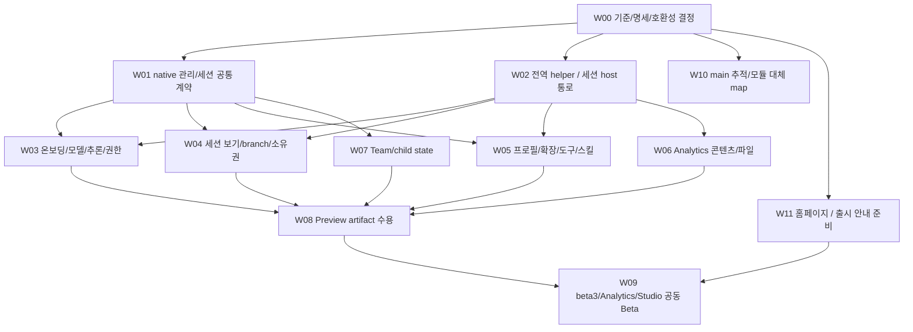

# 저장소별 작업 패키지와 공동 출시 gate

> 2026-10-24–25 소스 감사에서 작성한 설계다. 이 문서의 현재/미구현 표시는 당시 후보 기준이며, 현행 main·실행 Issue·착수 순서는 [readiness.md](readiness.md)에서 확인한다. 기술 제안과 제품 실행 수용은 구분한다.

상태: Proposed · 2026-10-24. 아래 ID는 **설계용 작업 ID**이며 생성된 GitHub Issue가
아니다. 기존 Issue/PR과 소유자를 확인한 뒤 해당 저장소 Project에 대응시킨다.
특히 진행 중인 ACP beta2 변경, Studio runtime-controls, 별도 upstream-policy를
설계 문서와 한꺼번에 commit/merge하지 않는다.

실행 Issue의 등록/배정/진행/결정/인계는 [공통 운영안](operating-model.md)을 따른다.
W00 착수 전에 정확한 통합 Project와 기존 작업 소유권을 확인하고, 사용자 아이디어는
Backlog에서 정리한다. 아래 W ID는 운영안의 실제 Issue로 등록되기 전까지 계획 ID다.

## 1. 의존 순서

공유 wire/schema/lock 계약은 먼저 직렬로 정한다. 이후 독립 UI/패키징 작업만
별도 Issue worktree로 병렬화한다. 같은 runtime manifest, lockfile, host composition
root, native command dispatcher를 여러 작업자가 동시에 바꾸지 않는다.

Preview와 첫 Beta 모두 기존 Aion UI 표면 연결을 우선한다. 새 전용 화면을 기본
결과물로 잡지 않고 기존 selector/설정창/agent·tool·skill 관리/sidebar/preview/browser와
native 기능의 binding을 작업 단위로 삼는다. 기존 표면으로 불가능한 필수 작업만
최소 UI를 보완한다. 화면의 큰 교체는 첫 Beta 이후 단계에서 검토한다.

| ID  | 주 저장소                                  | 범위와 결과물                                                                                                                                              | 선행                                             | 완료 판정                                                                                                        |
| --- | ------------------------------------------ | ---------------------------------------------------------------------------------------------------------------------------------------------------------- | ------------------------------------------------ | ---------------------------------------------------------------------------------------------------------------- |
| W00 | Studio + ACP + core                        | 확정 D01/D02, exact public-wheel baseline, compatibility/import-symbol matrix, 기능→Aion 표면 mapping, source receipts                                     | 없음                                             | beta.2 무수정·기존 CLI 기준을 확인하고 UI binding/명시 제외/실제 공백 구별                                       |
| W01 | native 계약 담당 + ACP/helper              | Preview는 기존 beta.2 API 사용·관찰/공유 store 한계 명시. Beta는 실제 공개 beta.3의 공통 auth/command/session/lock/revision·bounded history·cost wire 확인 | W00                                              | Preview 전용 core patch 없음. 공개 wheel별 계약·Windows 두 실제 프로세스 mutation/미지원·version/capability 확인 |
| W02 | Studio host/helper + ACP                   | sessionless 전역 stdio 관리 helper, 기존 ACP 경로 유지, custom session/client action·busy delivery·request metadata probe와 필요한 bounded forwarding      | W00                                              | 신규 auth가 LLM 없이 동작, 세션 감독자 하나, 최종 host wire의 응답·취소·비밀 비기록·unsupported 검증             |
| W03 | Studio + ACP/helper                        | 기존 Provider/settings/selector/context 표면에 bootstrap auth·모델/추론·Ask/Yolo·delivery·이미지/첨부 연결                                                 | W01/W02                                          | 신규 GUI 첫 응답, 실제 native 값 반영, Ask 거절/Yolo prompt 생략·idle restart 후 상태 확인                       |
| W04 | ACP + Studio + native 계약 담당            | 기존 sidebar/fork/import/clone/new/lineage UI에 native catalog/identity·원본 보존 연결. clear 신규 구현 제외                                               | W01/W02                                          | P: beta.2 읽기/분기 제약·HEAD cut 의미·실제 이력 복원. B: 공개 runtime 공통 lock/observation에 따른 안전한 인계  |
| W05 | Studio + native 관리                       | 기존 agent/tool/skill/설정 표면에 profile CRUD·identity·effective 리소스·writable package generation 연결. 없는 필수 관리 기능만 최소 보완                 | W01/W02                                          | 같은 profile의 CLI/Studio native prompt 일치, 실제 off, 실패 rollback, 앱 bundle 무수정                          |
| W06 | Studio + Analytics                         | 기존 파일/preview/browser/message card에 ref·다중 페이지 origin·Report/차트/코드/데이터·replay metadata 연결/강화                                          | W02                                              | 기존 표면에서 상대 자산·navigation·원본 hash·mobile·권한 경계를 실제 artifact로 수용                             |
| W07 | Studio + native/ACP                        | 실제 Aion Team tools, native child identity/진행/승인/취소/terminal state/reconnect                                                                        | W01/W02                                          | leader/teammate 실제 모델/도구와 child 상태 복구; startup만으로 pass 금지                                        |
| W08 | Studio + ACP                               | Preview wheel/bundle freeze, 5 target·WebUI·network mode·install lifecycle                                                                                 | W03–W07의 P gate                                 | final artifact digest와 P 사용자 여정 일치, 남은 blocker/예외 공개                                               |
| W09 | core + Analytics + ACP + Studio + 홈페이지 | 실제 beta.3/Analytics Beta wheels 재검증·migration·공동 게시·홈페이지 공개 확인                                                                            | W08 + W11 + 각 제품 gate                         | 아래 release train 전체와 G17 통과                                                                               |
| W10 | Studio                                     | upstream main/stable 이중 추적, provenance/history, module ownership와 cutover regression                                                                  | W00, 병행 가능                                   | 감지와 adoption을 분리하고 자동 회귀로 대체 영역의 재활성화를 차단                                               |
| W11 | Aelix 홈페이지 + 제품 문서                 | Studio 소개·제품 관계·스크린샷·OS별 다운로드·시작 안내·Beta 제한/릴리스 노트 연결 준비. 홈페이지 저장소/배포 경로는 착수 시 확인                           | W00 + Beta 기능/배포 정보 동결, 구현과 병행 가능 | 공개 전 미리보기의 내용/링크 검증. 실제 공개 확인 G17은 W09에서 수행                                             |

W01은 모든 기능을 agent-core에 집어넣는 이슈가 아니다. 재사용할 native 서비스는
coding-agent/built-in extension/control 쪽에 두고 kernel 변경을 최소화한다.
core가 필요한 blocker와 host-only UI를 나누어 실제 Issue로 더 잘게 분해한다.

## 2. Preview/Beta 필수 시나리오

| Gate                | 실증할 내용                                                                                                                                                          | 실패/회귀 사례                                                                                                                                   |
| ------------------- | -------------------------------------------------------------------------------------------------------------------------------------------------------------------- | ------------------------------------------------------------------------------------------------------------------------------------------------ |
| G01 신규 설치       | 소스·시스템 Python·uv가 없는 사용자 계정에서 install→Provider→첫 답변·tool approval                                                                                  | 잘못된 키/모델 권한/내부 CA/네트워크 오류, 중간 취소                                                                                             |
| G02 기존 CLI 사용자 | user config/auth/session 발견, 실제 사용 source 설명, 기존 JSONL 원본 보존                                                                                           | stale ACP preferences/held AuthStorage가 최신 CLI 선택·다른 Provider 갱신을 덮지 않음                                                            |
| G03 live controls   | 기존 selector/context UI에서 model/reasoning·Ask/Yolo·thought·usage·compact·Stop 확인                                                                                | Ask 거절/Yolo prompt 생략·native 거부 유지, 모드 변경/재개 불일치, unsupported level, busy, effects_unknown                                      |
| G04 세션            | 기존 Aion UI의 분기/이력 복제/import/new/resume/lineage가 실제 native identity/context로 연결, 재시작/reconnect                                                      | Aion DB만 복사하거나 새 context를 이력 clone이라 표시, 부모 leaf/config 변경, 잘못된 cut, 긴 기록, lost cursor. clear 신규 구현은 검사 대상 제외 |
| G05 writer/viewer   | P: legacy의 안전한 viewer/copy·신선도 수준·D01 제약. B: TUI/Studio live 보기, release→공통 lock→reload→continue. 불가하면 최소선은 양쪽 보유자 표시·idle 동기화(D03) | symlink alias, 죽은 PID 재사용, crash, 잠금 미지원 storage, 비협조 legacy b2, 보유자 오표시, idle 동기화·해제 후 상대 턴 누락                    |
| G06 리소스/프로필   | Coding·Analytics·사용자 프로필 생성, tools=[]와 skill/extension 실제 off                                                                                             | profile/operator grant 확대 거부, 모듈 import 실패, restart rollback                                                                             |
| G07 관리 환경       | 확장 local wheel/index 설치·업데이트·제거와 actual import, registry-scope 직렬 mutation                                                                              | signed app 무변경, 동시 package/profile 변경, dependency conflict, app upgrade 후 ABI 불일치                                                     |
| G08 콘텐츠          | Analytics init/import/query/run/record, HTML/CSS/JS/이미지·Report·코드/데이터 링크                                                                                   | script origin 경계, path traversal, 파일 크기 설정, 앱 이동/한글·공백 경로                                                                       |
| G09 Aion Team       | P/B: 실제 leader/teammate turn과 tool effects·승인·거부·cancel·status                                                                                                | 생성/attach만 성공, silent agent, 중단 후 잘못된 completed                                                                                       |
| G10 플랫폼          | darwin-arm64/x64, linux-arm64/x64, win32-x64의 final installer/image 핵심 여정                                                                                       | 빌드만 성공, uninstall 후 사용자 데이터 손실, process orphan                                                                                     |
| G11 WebUI/mobile    | 인증된 single-operator host, 세션·관리·승인·preview responsive UI                                                                                                    | unauth API/WS, Origin/CSRF, 큰 dialog/가상 키보드/작은 화면                                                                                      |
| G12 네트워크/배포   | public provider / internal endpoint / outbound denied를 따로 테스트                                                                                                  | cold install에서 package/asset download, telemetry·update fallback, 내부 auth/CA 실패                                                            |
| G13 native child    | B 추가: parent/child session·authority·진행·승인·cancel·재접속 terminal state                                                                                        | 실시간 event만 있고 durable snapshot 없음, 다른 child의 승인 오용                                                                                |
| G14 공유 config     | 공유 mutation을 제공하는 P/B 필수: Windows 포함 두 실제 CLI/Studio 프로세스의 auth/settings/profile 갱신·충돌                                                        | session lock만 사용, lost update, lock 교체, stale cache, crash 중 partial file. 비협조 legacy의 미보장 동시 mutation은 미지원/blocker로 표시    |
| G15 비명령 입력     | P/B: N01–N11의 stage에 따른 delivery·`!`/`!!`·이미지/첨부/paste 수용                                                                                                 | mode selector만 성공, 수동 명령이 LLM 입력으로 변환, 이미지 누락·large frame                                                                     |
| G16 rollback        | B 추가: app/runtime과 Studio projection만 호환 복구, 공유 원본은 보존                                                                                                | 업데이트 후 CLI가 만든 이력/설정/credential 변경이 예전 snapshot으로 유실/복원됨                                                                 |
| G17 공식 홈페이지   | B 필수: 홈페이지에서 Studio 소개→지원 OS 다운로드→설치/첫 실행 안내로 연결되고 공개 Beta와 내용·버전·지원 범위가 일치                                                | 소개가 초안에만 존재, 다운로드 404/잘못된 OS·버전, Preview/Beta 혼동, 미출시 기능 홍보, 시작 문서 누락                                           |

G14의 안전성은 Preview에서 공유 store mutation을 제공하면 즉시 적용한다. Beta로
검증을 미뤘다는 이유로 안전하지 않은 동시 갱신을 Preview에 허용하지 않는다.
공통 계약에 참여하지 않는 legacy CLI와의 동시 mutation은 보장하지 않으며,
지원 불가/충돌을 명확히 반환해야 한다. G16도 Preview에 rollback을 제공하면 적용한다.

G10에는 final installer의 압축/설치 크기·파일 수, install/첫 실행/upgrade/uninstall
시간과 clean 계정·디스크·OS·백신·하드웨어 조건을 함께 기록한다. 기존 Windows 설치
timeout 기록은 packaging 조사 근거이며 현재 설치 성공 증거가 아니다. 고정 시간/용량
목표는 이 문서에서 달성값으로 만들지 않고 초기 측정 후 제품 목표로 채택한다.

기존의 합성 Linux/Windows 검증, 실제 macOS Provider/브라우저 기록을 재사용할 수는
있지만 새 source/manifest/final artifact와 동일함을 확인해야 한다.
한 Provider 성공으로 모든 Provider를 수용했다고 하지 않는다. 실제 지원 Provider
catalog와 transport/auth 유형별 대표 조합을 freeze하여 유효/실패/갱신을 검사한다.

## 3. final artifact 증거 사슬

`installer/image digest → Studio release manifest → bundled manifest/checksums →`
`native/ACP/Analytics wheel + source + patch hashes → capability/schema → UI/native result`

- repository test, 설치된 wheel, real native process, synthetic model, real Provider,
  actual host UI, OS installer, network-isolated startup, 실데이터/오너 수용을 별도 기록.
- native-runtime job 성공은 installer upgrade/uninstall/Developer ID/notarization이나
  Linux desktop 환경의 실제 미리보기 수용이 아니다.
- Preview/Beta version과 upstream base version을 각각 표시한다. 버전 문자열 b2
  하나로 main source나 private patch를 감추지 않는다.
- supportedBuildTargets, acceptedTargets, known limits를 artifact에서 읽어 표시한다.
- Preview native beta.2 wheel hash는 배포 원본과 일치해야 한다. 명령 전수 신규 구현이
  아닌 제품 기능→Aion 표면→native 결과의 연결을 검증한다. Ask/Yolo는 새 adapter 작업이다.
- 무수정 wheel의 native import 심볼도 compatibility 계약에 포함한다. source tag 감사와
  공개 wheel byte 동일성·실제 설치 수용을 각각 확인한다.
- bootstrap CI `39916432666`이 green이어도 새 dirty runtime-controls/beta2 코드는
  그 결과의 대상이 아니다. 실제 통합 SHA에서 필요한 CI를 새로 완주한다.

## 4. 공동 Beta release train

1. core beta.3, Analytics Beta, ACP, Studio의 feature/capability/schema freeze.
   최신 beta.3 TUI inventory와 변경된 extension API를 matrix에 반영한다.
   홈페이지 W11의 소개·스크린샷·다운로드/문서 대상도 같은 기능/지원 범위에 맞춰 준비한다.
2. 각 저장소에서 reviewed SHA와 candidate wheels/images를 생성하고 hashes를 고정.
   source에서 직접 실행한 결과만으로 candidate wheel 수용을 대체하지 않는다.
3. Studio final candidate에 **배포할 바로 그 bytes**를 넣고 G01–G12,
   G14/G15와 Beta 추가 G13/G16, Preview→Beta migration(D13 이후 내부 검증 빌드 데이터), CLI version skew,
   native/Studio DB downgrade 범위를 검증.
4. core/Analytics/ACP 배포와 registry/artifact 다운로드를 확인한다. 공개 artifact의
   hash가 검증한 candidate와 다르면 중단하고 최종 bytes로 재검증한다.
5. 모든 dependency 확인 뒤 Studio release·installer/image를 게시하고 update manifest를 준비한다.
6. Aelix 공식 홈페이지에 Studio 소개·다운로드·시작 안내를 공개한다. 실제 공개 URL에서
   G17을 확인하고 core beta.3·Analytics Beta·Studio Beta의 버전/지원 범위와 일치시킨다.
7. 홈페이지와 공개 artifact 확인 뒤 update feed를 활성화하고 공동 출시를 발표한다.
   같은 발표/릴리스 창에 묶되 여러 registry와 홈페이지의 원자적 동시 게시를 가정하지 않는다.
8. 설치→업데이트→로그인/모델→기존 session/Analytics project 재개를 다시 관찰.
   실패 시 update feed rollout을 중지하고, 호환 app/runtime generation rollback
   또는 forward recovery를 택한다. Studio 전용 projection과 CLI 공유 원본을 분리한다.
   공유 원본 snapshot은 자동 복원하지 않고 모든 writer 정지·현재 대비 diff·명시적 복구로 한정한다.

core/Analytics의 독립 출시 조건을 Studio가 자동 충족시키지 않는다. Analytics의
owner UI-QA·real-data/publication gate가 열려 있으면 공동 train도 그 상태를 표시한다.
게시 후 artifact를 같은 버전명으로 바꾸거나 이미 실행된 tool을 rollback으로 지우지 않는다.

홈페이지 반영은 첫 Beta의 필수 출시 조건이다. 앱/패키지만 공개됐고 홈페이지가
미반영이거나 G17이 실패하면 공동 출시를 완료로 판정하지 않는다. 최소 내용은
Studio의 역할과 실제 제공 기능, 화면 예시, CLI·Studio·Analytics 관계, 검증된 OS별
다운로드, 신규/기존 CLI 사용자 시작 안내, WebUI/self-hosted·폐쇄망 문서 연결,
Beta 상태·알려진 제한·릴리스 노트다. 다운로드는 검증한 실제 배포 artifact를 가리킨다.

## 5. 이후의 대체 단계

| 단계 | Aelix가 새로 소유하는 영역                           | cutover 조건                                                                |
| ---- | ---------------------------------------------------- | --------------------------------------------------------------------------- |
| R1   | Provider/auth·프로필/리소스 관리 facade              | native 정본·진단·실제 화면이 완성되고 기존 Aion 설정과 혼동 없음            |
| R2   | 세션 catalog/observation·durable run/control service | CLI/Studio 공통 identity·lock·snapshot/cursor·재개 수용                     |
| R3   | 파일/Analytics 콘텐츠·PTY·원격 SSH host              | worker/file/terminal/content의 host/권한 일치, 재접속·종료·동일 작업 재개   |
| R4   | Team orchestration·장기 작업·조직 운영               | child authority·run state·audit·backup/restore 수용, 이중 orchestrator 제거 |
| R5   | 필요한 upstream UI/backend 모듈                      | ownership map·migration·rollback 완료; 나머지 component는 계속 재사용 가능  |

main 감지 report에는 upstream commit, 영향받는 module, security/compatibility,
adopt/review/defer/reject 이유를 남긴다. stable release·보안 backport 채택 기록은
별도다. upstream fetch/merge는 검토 branch에서 수행하며 사용자 배포와 분리한다.
운영 중인 session에 새 control path를 자동 적용하지 않는다.
